<!-- Generated by tools/build.cjs. Edit design/content.json. Keep adjacent image links joined. -->

<a href="https://antonio-portfolio-ashy.vercel.app/#/work"><picture><source media="(max-width: 600px)" srcset="assets/noir/hero-mobile.png"><source media="(max-width: 1100px)" srcset="assets/noir/hero-compact.png">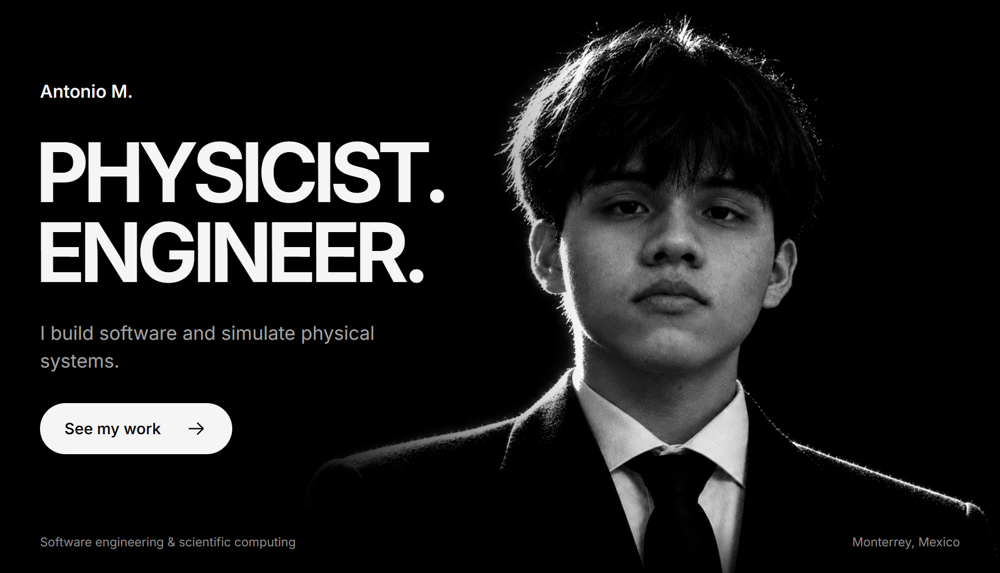</picture></a> 
<a href="https://antonio-portfolio-ashy.vercel.app/#/work"><picture><source media="(max-width: 600px)" srcset="assets/noir/work-heading-mobile.png"><source media="(max-width: 1100px)" srcset="assets/noir/work-heading-compact.png">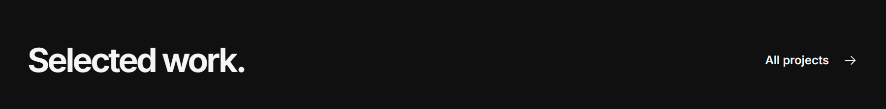</picture></a> 
<a href="https://antonio-portfolio-ashy.vercel.app/#/work/data-language"><picture><source media="(max-width: 600px)" srcset="assets/noir/abstract-mobile.png"><source media="(max-width: 1100px)" srcset="assets/noir/abstract-compact.png">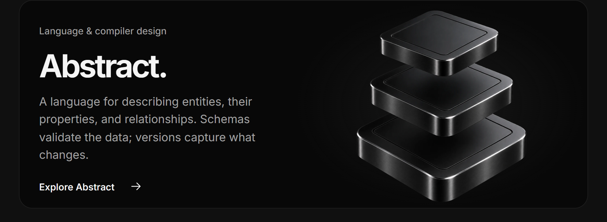</picture></a> 
<a href="https://antonio-portfolio-ashy.vercel.app/#/work/compact-serialization"><picture><source media="(max-width: 600px)" srcset="assets/noir/compact-mobile.png"><source media="(max-width: 1100px)" srcset="assets/noir/compact-compact.png">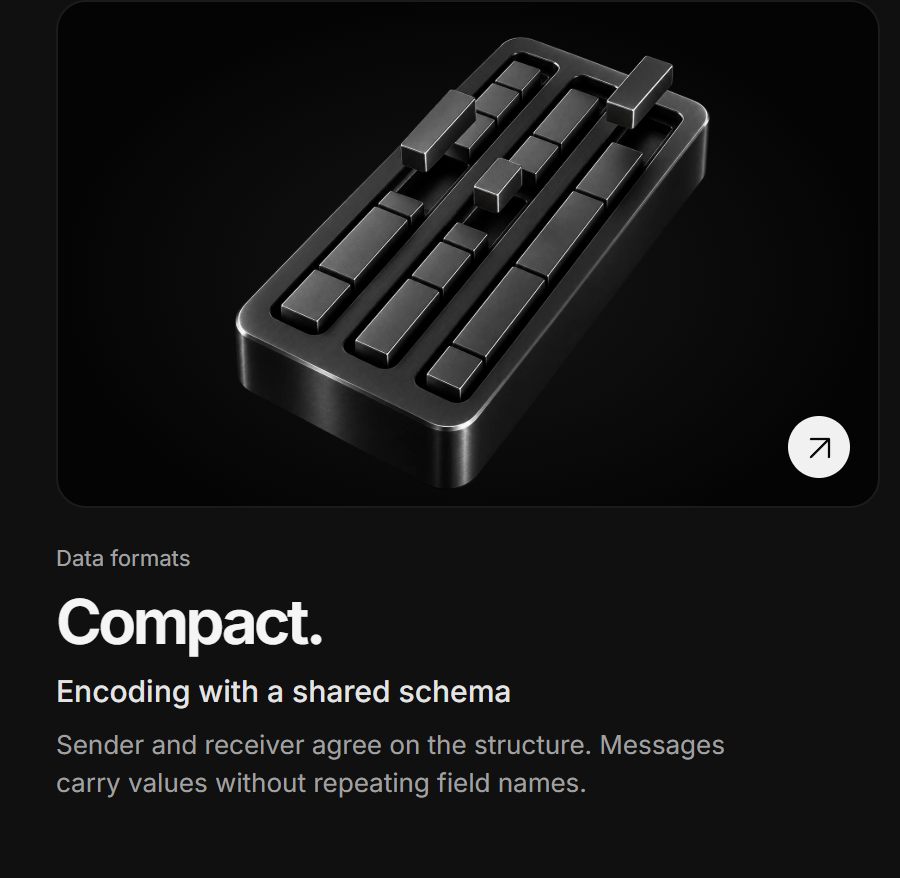</picture></a><a href="https://antonio-portfolio-ashy.vercel.app/#/work/coupled-pendulum"><picture><source media="(max-width: 600px)" srcset="assets/noir/pendulum-mobile.png"><source media="(max-width: 1100px)" srcset="assets/noir/pendulum-compact.png">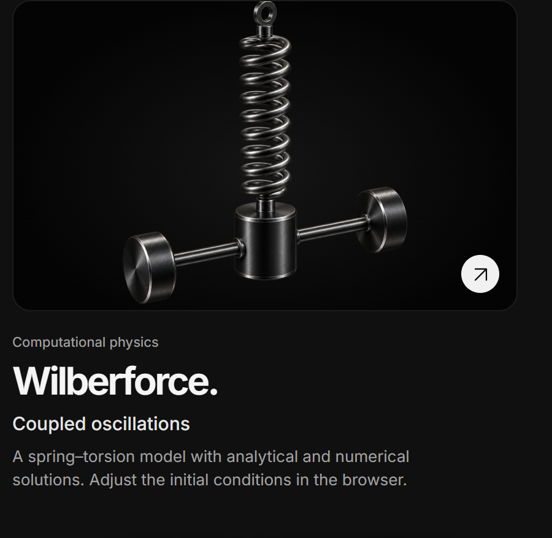</picture></a> 
<a href="https://antonio-portfolio-ashy.vercel.app/#/about"><picture><source media="(max-width: 600px)" srcset="assets/noir/mindset-mobile.png"><source media="(max-width: 1100px)" srcset="assets/noir/mindset-compact.png">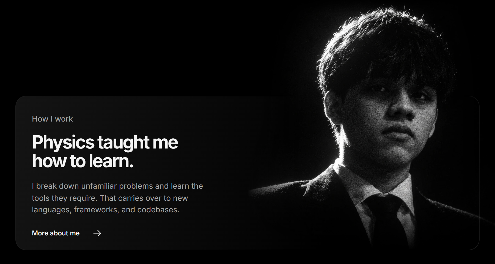</picture></a> 
<picture><source media="(max-width: 600px)" srcset="assets/noir/contact-heading-mobile.png"><source media="(max-width: 1100px)" srcset="assets/noir/contact-heading-compact.png">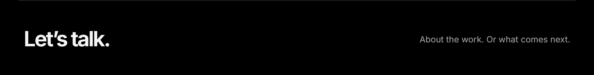</picture> 
<a href="mailto:yosoyantoniomartinez@gmail.com"><picture><source media="(max-width: 600px)" srcset="assets/noir/contact-email-mobile.png"><source media="(max-width: 1100px)" srcset="assets/noir/contact-email-compact.png">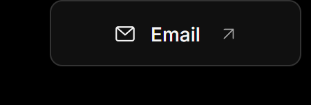</picture></a><a href="https://www.linkedin.com/in/antonio-in-stem/"><picture><source media="(max-width: 600px)" srcset="assets/noir/contact-linkedin-mobile.png"><source media="(max-width: 1100px)" srcset="assets/noir/contact-linkedin-compact.png"></picture></a><a href="https://antonio-portfolio-ashy.vercel.app/"><picture><source media="(max-width: 600px)" srcset="assets/noir/contact-portfolio-mobile.png"><source media="(max-width: 1100px)" srcset="assets/noir/contact-portfolio-compact.png">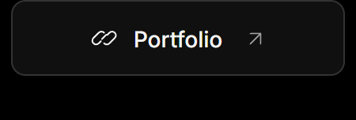</picture></a><a href="https://github.com/antonio-in-stem"><picture><source media="(max-width: 600px)" srcset="assets/noir/contact-github-mobile.png"><source media="(max-width: 1100px)" srcset="assets/noir/contact-github-compact.png">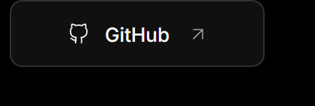</picture></a> 
<picture><source media="(max-width: 600px)" srcset="assets/noir/colophon-mobile.png"><source media="(max-width: 1100px)" srcset="assets/noir/colophon-compact.png">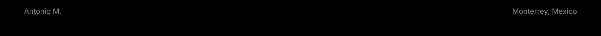</picture>

Read as text

# Antonio M.

**Physicist · Software Engineer**

I build software and simulate physical systems. Based in Monterrey, Mexico.

## How I work

Physics taught me how to learn. I break down unfamiliar problems and learn the tools they require. That carries over to new languages, frameworks, and codebases.

[More about me](https://antonio-portfolio-ashy.vercel.app/#/about)

## Selected work

### [Abstract](https://antonio-portfolio-ashy.vercel.app/#/work/data-language)

A language for describing entities, their properties, and relationships. Schemas define the rules, references connect records, and versions capture changes. A Rust compiler validates the source and emits structured data.

### [Compact](https://antonio-portfolio-ashy.vercel.app/#/work/compact-serialization)

A format for exchanging values when both programs already agree on the schema. Messages omit repeated field names and types. The portfolio includes an interactive encoder and decoder.

### [Wilberforce pendulum](https://antonio-portfolio-ashy.vercel.app/#/work/coupled-pendulum)

A model of coupled vertical and torsional motion, with analytical solutions and an RK4 solver. Adjust the initial conditions and inspect the energy exchange in the browser. Developed with Aarón Marcelo Sandoval Vázquez and Diego Jorge Gómez.

## Laboratory

- [Render LLM](https://antonio-portfolio-ashy.vercel.app/#/work/rendering-system) — A completed tool for my own rendering workflow, with Flame, MCP tools, and an HTTP API. The version intended for public release was not finished. No public download or live demo.
- [Diffusion](https://antonio-portfolio-ashy.vercel.app/#/work/verified-runtime) — A prototype for signed software releases and controlled module loading. Development stopped after a technical blocker; there is no finished public release.

## Connect

[Email](mailto:yosoyantoniomartinez@gmail.com) · [LinkedIn](https://www.linkedin.com/in/antonio-in-stem/) · [Portfolio](https://antonio-portfolio-ashy.vercel.app/)

